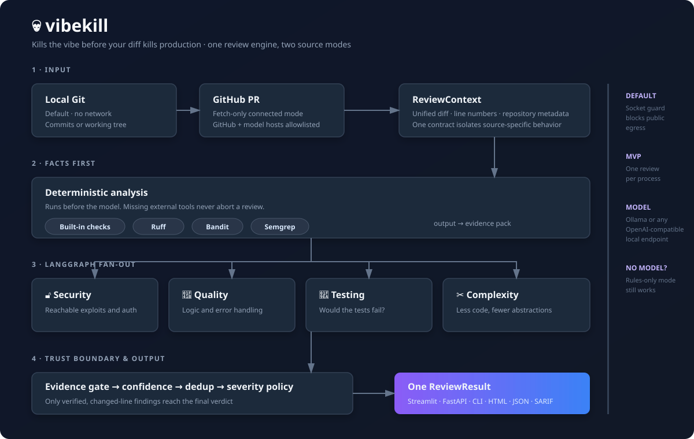

# Architecture

How vibekill is put together and why. Read this before making a structural change.



The diagram is the fast path. The sections below explain the contracts and trade-offs behind it.

## Guiding constraints

Four constraints shaped nearly every decision:

1. **The target is code that looks fine.** vibekill is aimed at AI-generated
   changes, which fail differently from human ones: clean surface, plausible
   structure, wrong in ways that do not show up as ugly code. That rules out
   style checking as a priority and rules *in* reachability, assertion strength,
   and volume — the things a human skimming a tidy diff will miss.
2. **The model may be small.** An air-gapped site runs what its hardware allows.
   The design assumes a 7B–30B local model, not a frontier one, so the system is
   built to make a modest model useful rather than to rely on a strong one.
3. **Precision over recall.** A noisy reviewer gets muted, and a muted reviewer
   catches nothing. Given a choice between missing a finding and emitting a false
   one, vibekill misses it.
4. **Offline is the default, not a mode.** Everything works with no network and no
   model. Features that need either are additive.

## Layers

```
┌─ 1 · Source adapters ───────────────────────────────────────────┐
│  LocalGitSource (git)          GitHubPRSource (API)             │
└──────────────────────────┬──────────────────────────────────────┘
                           ▼
                    ReviewContext          normalised, source-agnostic
                           │
┌─ 2 · Deterministic analysis ─┴──────────────────────────────────┐
│  ruff · bandit · semgrep          separate processes, parallel  │
│  built-in heuristics             pure Python, always available  │
└──────────────────────────┬──────────────────────────────────────┘
                           ▼
                     Evidence Pack         facts the agents reason over
                           │
┌─ 3 · Agent layer (LangGraph) ┴──────────────────────────────────┐
│  security   quality   testing   complexity                      │
│  one super-step, concurrent; model calls behind a semaphore      │
└──────────────────────────┬──────────────────────────────────────┘
                           ▼
┌─ 4 · Aggregation ─────────────────────────────────────────────── ┐
│  evidence gate → corroboration → dedup → severity policy        │
└──────────────────────────┬──────────────────────────────────────┘
                           ▼
┌─ 5 · Sinks ─────────────────────────────────────────────────────┐
│  markdown · HTML · JSON · SARIF · GitHub review                 │
└─────────────────────────────────────────────────────────────────┘
```

## Module map

| Module | Responsibility |
|---|---|
| `models.py` | Domain types. No I/O, no dependencies. The contract every layer speaks. |
| `settings.py` | Config from defaults, TOML and `VIBEKILL_*` env. |
| `airgap.py` | Socket-level egress guard. |
| `diffparse.py` | Unified diff → `FileDiff`/`Hunk` with resolved line numbers. |
| `sources.py` | `LocalGitSource`, `GitHubPRSource`. Both return `ReviewContext`. |
| `analysis/heuristics.py` | Built-in checks. No external deps. |
| `analysis/tools.py` | Wrappers for ruff, bandit, semgrep. |
| `llm.py` | Local model client and JSON recovery. |
| `agents/base.py` | The shared agent loop: chunk, prompt, parse. |
| `agents/*.py` | One file per agent: prompt, evidence filter, severity cap. |
| `graph.py` | LangGraph orchestrator. |
| `aggregate.py` | Evidence gate, dedup, severity policy, verdict. |
| `report/` | Renderers and the HTML template. |
| `pipeline.py` | `run_review`, the single entry point. |
| `cli.py` / `api.py` / `ui.py` | The three surfaces. All call `run_review`. |

Dependency direction is strictly downward: `models.py` imports nothing of ours,
and nothing imports the surfaces.

## Layer 1 — sources

Both adapters produce a `ReviewContext`, which is what stops the two modes from
drifting. A divergence in the diff layer is exactly the bug that would make an
air-gapped review disagree with a hosted one.

Local git uses `merge-base(base, head)` rather than diffing the refs directly, so
the review covers this branch's work and not everything that landed on the base
branch since the fork.

`ReviewContext` also carries a **repo file index** — tracked paths, no contents.
It exists solely so the complexity agent can ask "does `utils/retry.py` already do
this?". Without it that agent can only give generic advice.

## Layer 2 — deterministic analysis

Runs before any model, and its output is the agents' input.

Two reasons this ordering is load-bearing:

- It reframes the model's task. Detection from scratch is hard for a 7B model;
  triaging a rule-engine hit ("is this reachable, does it matter here, what is the
  real fix?") is much easier and plays to what a language model is good at.
- The tool must work with the model off. `--provider none` is a supported
  configuration, and the built-in heuristics are the only analyser guaranteed to
  exist in a locked-down install, since nobody there can `pip install semgrep`.

This is the one layer with genuine parallelism: separate processes doing CPU work.

Findings are filtered to lines the diff touched. Without that, a one-line change
to a legacy file produces a wall of pre-existing issues, which is the fastest way
to teach people to ignore the bot.

## Layer 3 — agents

Every agent shares one loop in `agents/base.py` and differs only in prompt,
evidence filter, and severity cap. A new agent is ~40 lines.

**Agents return only their own model findings.** Deterministic findings travel to
the aggregator separately. Agents read them as evidence but never re-emit them,
or every tool finding would be counted twice.

**Map-reduce over the diff.** Files are grouped into chunks that fit the context
budget (characters, ~4 per token — no tokenizer ships into an air-gapped install).
Each chunk is one call; a reduce step produces the agent's summary. Forced by
small local context windows.

**Severity caps per agent.** Only the security agent may propose `blocker`. The
complexity agent tops out at `major`, because excess complexity is a cost argument
the author gets to weigh, not a merge blocker.

### Concurrency, honestly

LangGraph schedules the four agent nodes in one super-step, so they do run
concurrently. But their model calls pass through a semaphore in `LLMClient`
(default 2), because one runtime serving four callers does not go faster — the
weights cross the memory bus per token regardless of who is waiting.

Expect `chunks × per-call latency / 2` plus analyser time. If the box has VRAM
headroom, two model instances with agents pinned to each is the real lever.

Concurrent writes to shared graph state need a reducer, hence
`Annotated[list[AgentResult], operator.add]`. Without it, four nodes writing the
same key overwrite each other and three results vanish silently.

## Layer 4 — aggregation

Where trust is bought.

### Evidence gate

Every model finding must carry `path`, `line`, and a verbatim quote. The
aggregator reads the real line and compares, normalising whitespace and quote
style. Three outcomes:

- quote matches → kept, tagged `evidence-verified`
- quote is real but the line number is wrong → line corrected, tagged
  `evidence-relocated`, confidence reduced slightly
- quote matches nothing → dropped and counted

Relocating rather than discarding matters: a correct observation with a
miscounted line number is a formatting slip, not a hallucination.

### Corroboration

A model finding that a tool independently flagged at the same location gets a
confidence bonus. Agreement between a rule engine and a language model is
stronger evidence than either alone because they fail in unrelated ways.

### Dedup

Two findings are the same defect when they are on the same path within a small
line window **and** they agree. The discriminator is the quoted evidence, used in
both directions:

- both quote the same code → same defect, merge
- both quote *different* code → different defects, keep separate even if adjacent
- one has no quote (common for tool findings) → fall back to category or wording

Proximity alone cannot distinguish "two agents describing one defect differently"
from "two real defects side by side"; the quote can.

### Severity policy

No model escalates to `blocker` on its own judgement. `blocker` survives only
with tool corroboration, or as a security finding with verified evidence and
confidence ≥ 0.75. Everything else is capped at `major` and tagged
`capped-uncorroborated`.

## Layer 5 — sinks

Four renderers over one `ReviewResult`, so terminal and HTML cannot disagree.
HTML is self-contained — inline styles, no external assets — because the report
often has to open from a share drive on a machine with no network. SARIF exists so
connected deployments get inline PR annotations through GitHub's own code scanning
rather than vibekill posting comments.

## Air-gap enforcement

`airgap.py` patches `socket.connect`, `connect_ex`, `create_connection` and
`getaddrinfo`. Non-allowlisted hosts raise `EgressBlocked`. Name resolution is
blocked too, because a DNS query is already traffic leaving the machine.

Child analysers get `subprocess_env()`: proxies pointed at a closed port,
telemetry opt-outs, and `GITHUB_TOKEN` / `SEMGREP_APP_TOKEN` / `OPENAI_API_KEY`
stripped from what they inherit — a stale token is the classic way an
"air-gapped" tool ends up authenticating to something.

`semgrep --config auto` is **refused** offline. It sends languages, frameworks and
the project URL to the Semgrep registry to choose rules. Code is not uploaded, but
that metadata is precisely what an air-gapped deployment exists to keep in.

**Limit:** this constrains Python, not arbitrary subprocesses. A container with
no network interface is the real boundary; the guard complements it and catches
the accidental case, which is the one that actually happens. `vibekill doctor` and
`GET /airgap` actively attempt egress and assert it fails, so the claim is
auditable.

## Design decisions and their trade-offs

| Decision | Why | Cost |
|---|---|---|
| Tools feed the model | Easier task for a small model; works with no model | Tool output can bias the agents toward what it already found |
| Evidence gate on by default | Kills invented locations | Loses valid findings a model states without a quote |
| Changed lines only | Authors see what they caused | Pre-existing issues next to new code go unmentioned |
| Thin LLM client instead of LangChain chat models | ~150 readable lines, no extra dep tree | Must hand-write each provider |
| LangGraph for orchestration only | Gives parallel fan-out and a clear graph | A framework dependency for a deliberately small graph |
| Synchronous stateless API | No unsafe job lifecycle or hidden work | Callers queue externally if they need async execution |
| One review per process | Makes the process-wide socket guard safe | Scale with service processes, not threads |
| Characters as the token budget | No tokenizer in an offline install | Approximate; final prompts are hard-capped |

## Where to extend

- **A check** → one function in `analysis/heuristics.py` with `@check`.
- **An agent** → subclass `Agent`, append to `AGENT_CLASSES`, add a settings field.
- **A source** → implement `fetch() -> ReviewContext`, add to `build_source`.
- **A tool** → a runner returning `ToolOutcome`, register in `RUNNERS`.
- **Synchronous local API** → one review per process; callers own queuing.
- **A report format** → a function plus an entry in `RENDERERS`.

Details in [CONTRIBUTING.md](../CONTRIBUTING.md).

## Not built yet

Roughly in the order I would do them:

1. **Finding cache** keyed on `(diff hash, model, prompt version, ruleset hash)`,
   so re-running on an unchanged diff is free and CI output is stable.
2. **Baseline/suppression file** by fingerprint, so a large existing repo can
   adopt vibekill without 4,000 opening findings.
3. **Posting reviews to GitHub.** v0.1 fetches PRs and returns the report locally;
   it never writes comments or review state back to GitHub.
4. **JS/TS AST checks** to match the Python ones. Today they get regex + agents.
5. **Semantic reinvention detection** with local embeddings over the repo.
6. **Evaluation harness** — a labelled corpus of diffs with known defects, so
   prompt changes can be measured instead of guessed at. This is what I would
   build before tuning any prompt further.
